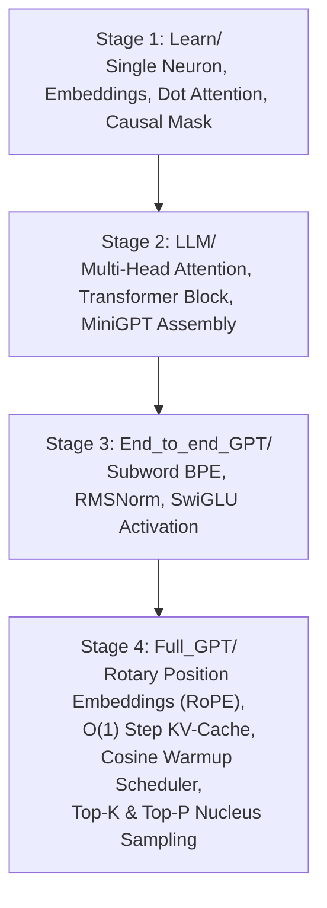

# 🧠 Building a Modern LLM From Scratch (PyTorch)

A step-by-step engineering and learning journey building a Generative Pretrained Transformer (GPT) completely from first principles in PyTorch—progressing from a single artificial neuron to a modern, production-grade autoregressive Large Language Model with **RoPE (Rotary Position Embeddings)**, **RMSNorm**, **SwiGLU**, **Byte-Level BPE**, and **KV-Cache**.

---

## 📋 Table of Contents

- [Overview](#-overview)
- [The Learning Journey (Roadmap)](#-the-learning-journey-roadmap)
  - [Stage 1: Deep Learning Foundations (`Learn/`)](#stage-1-deep-learning-foundations-learn)
  - [Stage 2: Modular Attention & Transformers (`LLM/`)](#stage-2-modular-attention--transformers-llm)
  - [Stage 3: End-to-End Character & BPE Models (`End_to_end_GPT/`)](#stage-3-end-to-end-character--bpe-models-end_to_end_gpt)
  - [Stage 4: State-of-the-Art Modern GPT (`Full_GPT/`)](#stage-4-state-of-the-art-modern-gpt-full_gpt)
- [Architecture & Modern Innovations](#-architecture--modern-innovations)
  - [1. Rotary Positional Embeddings (RoPE)](#1-rotary-positional-embeddings-rope)
  - [2. Root Mean Square Normalization (RMSNorm)](#2-root-mean-square-normalization-rmsnorm)
  - [3. SwiGLU Activation](#3-swiglu-activation)
  - [4. Key-Value (KV) Caching](#4-key-value-kv-caching)
  - [5. Byte-Level BPE Tokenizer](#5-byte-level-bpe-tokenizer)
- [Repository Structure](#-repository-structure)
- [Recreating & Running `Full_GPT`](#-recreating--running-full_gpt)
  - [1. Environment Setup](#1-environment-setup)
  - [2. Training the Tokenizer](#2-training-the-tokenizer)
  - [3. Inspecting / Modifying Hyperparameters](#3-inspecting--modifying-hyperparameters)
  - [4. Training the Model](#4-training-the-model)
  - [5. Verifying the KV Cache](#5-verifying-the-kv-cache)
  - [6. Generating Text (Inference)](#6-generating-text-inference)
- [Sampling Strategies Explained](#-sampling-strategies-explained)
- [Summary of Progression](#-summary-of-progression)

---

## 🌟 Overview

Modern Large Language Models (such as LLaMA 2/3, Mistral, and Gemma) incorporate significant architectural refinements over the original 2017 Transformer (*"Attention Is All You Need"*) and GPT-2/3.

This repository tracks the entire progression:
1. **Mathematical fundamentals**: Gradients, single neurons, feed-forward layers, manual attention calculations.
2. **Standard Transformer**: Multi-head self-attention, causal masking, absolute positional embeddings, standard layer normalization.
3. **Modern Foundation LLM Architecture**:
   - **RoPE** replacing absolute positional embeddings for superior length generalization.
   - **RMSNorm** replacing LayerNorm for faster training and numerical stability.
   - **SwiGLU** replacing traditional ReLU/GELU MLPs for improved representational capacity.
   - **KV-Cache** enabling $O(1)$ token generation step latency.
   - **Byte-Level BPE** (8,000 vocab) for robust subword tokenization without out-of-vocabulary bottlenecks.

---

## 🚀 The Learning Journey (Roadmap)

### Stage 1: Deep Learning Foundations (`Learn/`)
Focuses on understanding how individual neural components operate and how forward and backward passes function in PyTorch:
- `neuron.py`: A single scalar neuron ($y = w \cdot x + b$) with autograd.
- `layer.py` & `network.py`: Linear transformations and multi-layer perceptrons.
- `Token_Embedding.py`: Mapping discrete token IDs to dense vectors (`nn.Embedding`).
- `PositionE_mbedding_with_Batches.py`: Absolute position embeddings combined with token embeddings across batch dimensions.
- `attention.py`: Dot-product attention mechanism ($QK^T / \sqrt{d_k}$).
- `causal_attention.py`: Autoregressive lower-triangular causal masking so tokens cannot attend to the future.
- `Layer_normalization.py` & `Residual_Connections.py`: Normalization and skip connections preventing gradient vanishing.
- `Batching.py`: Preparing tensor batches with context windows.

---

### Stage 2: Modular Attention & Transformers (`LLM/`)
Packages learned primitives into clean, reusable PyTorch modules:
- `self_attention.py`: Scaled dot-product self-attention class.
- `Multi_Head_Attention.py`: Splitting embeddings into $H$ parallel heads.
- `TransformerBlock.py`: Pre-layer normalization transformer block (Attention + MLP + Residuals).
- `miniGPT.py`: Assembled model accepting token sequences and outputting vocabulary logits.
- `train.py`: Basic cross-entropy optimization loop.

---

### Stage 3: End-to-End Character & BPE Models (`End_to_end_GPT/`)
A bridge toward modern architectures:
- Integrates the Hugging Face `tokenizers` library for custom Byte-Pair Encoding (BPE).
- Introduces **RMSNorm** and **SwiGLU** in `GPT.py`.
- Implements end-to-end tokenization and training scripts (`train_tokenizer.py`, `train_model.py`, `generate.py`).

---

### Stage 4: State-of-the-Art Modern GPT (`Full_GPT/`)
The pinnacle of the project—implements the modern open-source LLM standard (LLaMA/Mistral architecture):
- **RoPE (Rotary Position Embeddings)** replaces absolute position tables.
- **Fast KV-Cache** during autoregressive generation for real-time decoding.
- **Verified KV Cache Testing** via `test_kv_cache.py`.
- **Cosine Learning Rate Schedule with Warmup** in `train.py`.
- **Multi-strategy Text Generation** in `generate.py` supporting Temperature, Top-$k$, and Top-$p$ (Nucleus) sampling.

---

## 🔬 Architecture & Modern Innovations

| Component | Classical GPT (GPT-2) | Modern Implementation (`Full_GPT`) | Advantage |
| :--- | :--- | :--- | :--- |
| **Positional Encoding** | Absolute Learned Embeddings | **Rotary Position Embeddings (RoPE)** | Captures relative distance; supports longer contexts |
| **Normalization** | Standard LayerNorm ($\mu, \sigma^2$) | **RMSNorm** | Omits mean calculation; faster computation & stable gradients |
| **Activation & FFN** | GELU / ReLU MLP | **SwiGLU** | Gated linear unit; higher quality per parameter count |
| **Inference Generation** | Full-context recomputation ($O(T^2)$) | **KV-Cache** ($O(1)$ per step) | Massive speedup during autoregressive decoding |
| **Tokenization** | Character-level / Simple | **Byte-Level BPE (8k vocab)** | Handles arbitrary text, emojis, and code without `<UNK>` |

### 1. Rotary Positional Embeddings (RoPE)
Instead of adding positional vectors to token embeddings, RoPE rotates Query and Key representations in 2D coordinate slices based on their sequence position $m$:

$$\mathbf{R}_{\Theta, m}^d = \text{diag}\left(R_{\theta_1, m}, R_{\theta_2, m}, \dots, R_{\theta_{d/2}, m}\right)$$

In `Full_GPT/model.py`:
```python
def apply_rope(x, start_position=0):
    B, H, T, D = x.shape
    half_dim = D // 2
    theta = 10000.0 ** (-torch.arange(0, half_dim, device=x.device, dtype=torch.float32) / half_dim)
    positions = torch.arange(start_position, start_position + T, device=x.device, dtype=torch.float32)
    angles = positions[:, None] * theta[None, :]
    cos = torch.cos(angles)[None, None, :, :]
    sin = torch.sin(angles)[None, None, :, :]
    x1 = x[..., :half_dim]
    x2 = x[..., half_dim:]
    return torch.cat([x1 * cos - x2 * sin, x1 * sin + x2 * cos], dim=-1)
```

### 2. Root Mean Square Normalization (RMSNorm)
RMSNorm scales inputs using the root mean square of their activations without computing or subtracting the mean:

$$\text{RMSNorm}(x) = \frac{x}{\sqrt{\frac{1}{d}\sum_{i=1}^d x_i^2 + \epsilon}} \odot \gamma$$

In `Full_GPT/model.py`:
```python
class RMSNorm(nn.Module):
    def __init__(self, embedding_size, eps=1e-6):
        super().__init__()
        self.weight = nn.Parameter(torch.ones(embedding_size))
        self.eps = eps

    def forward(self, x):
        rms = torch.sqrt(x.pow(2).mean(dim=-1, keepdim=True) + self.eps)
        return self.weight * (x / rms)
```

### 3. SwiGLU Activation
A Gated Linear Unit with the Swish ($\text{SiLU}$) activation function:

$$\text{SwiGLU}(x) = \left(\text{SiLU}(x W_{\text{gate}}) \odot x W_{\text{up}}\right) W_{\text{down}}$$

In `Full_GPT/model.py`:
```python
class SwiGLU(nn.Module):
    def __init__(self, embedding_size, hidden_size):
        super().__init__()
        self.gate = nn.Linear(embedding_size, hidden_size)
        self.up = nn.Linear(embedding_size, hidden_size)
        self.down = nn.Linear(hidden_size, embedding_size)

    def forward(self, x):
        gate = F.silu(self.gate(x))
        up = self.up(x)
        return self.down(gate * up)
```

### 4. Key-Value (KV) Caching
During autoregressive generation, without a KV cache, computing token $T+1$ recomputes Keys and Values for all preceding tokens $1 \dots T$. With KV caching:
- The initial prompt builds the cache `(past_k, past_v)` for each layer.
- At each subsequent step, only the new token is fed forward ($T=1$).
- Keys and Values of the new token are appended to `past_k` and `past_v`.
- The attention is computed using the single query against all cached keys and values.

Verified in `Full_GPT/test_kv_cache.py` with exact numerical agreement (`torch.allclose(cached, full, atol=1e-5)`).

### 5. Byte-Level BPE Tokenizer
Trained with Hugging Face's `tokenizers` library using a ByteLevel pre-tokenizer and ByteLevel decoder:
- Vocabulary Size: 8,000 subword units.
- Operates on raw bytes, avoiding out-of-vocabulary (`<UNK>`) problems.

---

## 📁 Repository Structure

```text
llm_from_scratch/
│
├── Full_GPT/                       # 🌟 Final State-of-the-Art RoPE GPT implementation
│   ├── config.py                   # Centralized model & training hyperparameters
│   ├── model.py                    # MiniGPT (RoPE, RMSNorm, SwiGLU, MultiHeadAttention, KV-Cache)
│   ├── train_tokenizer.py          # Trains Byte-Level BPE tokenizer
│   ├── train.py                    # Training loop with warmup, cosine decay & checkpointing
│   ├── generate.py                 # Fast generation with KV caching, top-k, top-p, temperature
│   ├── test_kv_cache.py            # Unit test ensuring KV-cache matches full attention
│   ├── tokenizer.json              # Trained subword vocabulary file
│   ├── best_model_rope.pth         # Saved weights and training state
│   └── input.txt                   # Training corpus
│
├── End_to_end_GPT/                 # Stage 3: Modular BPE GPT with RMSNorm & SwiGLU
│   ├── GPT.py                      # GPT model implementation
│   ├── Tokenizer.py                # Tokenizer utilities
│   ├── train_tokenizer.py          # Tokenizer trainer
│   ├── train_model.py              # Model training script
│   ├── generate.py                 # Text generation script
│   └── tokenizer.json              # Saved tokenizer
│
├── LLM/                            # Stage 2: Modular standard Transformer blocks
│   ├── self_attention.py           # Single head self-attention
│   ├── Multi_Head_Attention.py     # Multi-head attention implementation
│   ├── TransformerBlock.py         # Transformer Block (LayerNorm + MHA + MLP)
│   ├── miniGPT.py                  # Standard MiniGPT model
│   └── train.py                    # Training script
│
├── Learn/                          # Stage 1: Foundational experiments from scratch
│   ├── neuron.py                   # Scalar neuron with autograd
│   ├── layer.py                    # Dense linear layer
│   ├── network.py                  # Simple neural network
│   ├── Token_Embedding.py          # Token embeddings
│   ├── PositionE_mbedding_...py    # Absolute positional embeddings with batches
│   ├── attention.py                # Scaled dot-product attention
│   ├── causal_attention.py         # Causal attention with mask
│   ├── Layer_normalization.py      # Layer normalization from scratch
│   ├── Residual_Connections.py     # Residual skip connections
│   ├── Feed-Forward_Network.py     # Feed-forward network
│   ├── Batching.py                 # Batch generator
│   └── test_MiniGPT.py             # Early integration tests
│
├── full_gpt.py                     # Standalone character-level GPT script
├── full_gpt_bpe.py                 # Standalone BPE GPT script
├── shakespeare.txt                 # Alternative Shakespeare training corpus
└── README.md                       # Documentation & guide
```

---

## 🛠️ Recreating & Running `Full_GPT`

Follow this guide to recreate, train, and test the final `Full_GPT` model from scratch.

### 1. Environment Setup

Ensure you have Python 3.9+ and PyTorch installed:

```bash
# Install PyTorch (adjust for your CUDA version if using GPU)
pip install torch --index-url https://download.pytorch.org/whl/cu121

# Install Hugging Face tokenizers
pip install tokenizers
```

Navigate to the `Full_GPT` folder:
```bash
cd Full_GPT
```

---

### 2. Training the Tokenizer

Prepare your training text file as `input.txt` (or use the provided corpus), then train the Byte-Level BPE tokenizer:

```bash
python train_tokenizer.py
```

This will generate `tokenizer.json` with a vocabulary size of 8,000 subwords:
```text
Tokenizer trained!
Vocabulary size: 8000
Original: The transformer model learns language.
Token IDs: [478, 10567, 1845, 12948, 3816, 17]
Decoded: The transformer model learns language.
```

---

### 3. Inspecting / Modifying Hyperparameters

Configuration is centralized in `Full_GPT/config.py`:

```python
# config.py

# Tokenizer and data
vocab_size = 8000
tokenizer_file = "tokenizer.json"
data_file = "input.txt"

# Model architecture
embedding_size = 128
num_heads = 4
num_blocks = 4
sequence_length = 128
ffn_hidden_size = 512

# Training settings
batch_size = 8
learning_rate = 3e-4
min_learning_rate = 3e-5
warmup_steps = 500
num_steps = 10000

# Checkpoint
checkpoint_file = "best_model_rope.pth"
```

---

### 4. Training the Model

Execute the training script:

```bash
python train.py
```

**Training Highlights:**
- **Automatic Device Selection**: Detects and utilizes CUDA GPU if available, else CPU.
- **Warmup & Cosine Decay Schedule**:
  - Warmup for the first 500 steps up to $3\times 10^{-4}$.
  - Cosine decay smoothly lowers the learning rate to $3\times 10^{-5}$ across 10,000 steps.
- **Periodic Evaluation**: Evaluates train and validation loss every 500 steps.
- **Model Checkpointing**: Whenever validation loss improves, saves the full model state dict, step, and architecture metadata to `best_model_rope.pth`.

Sample training log:
```text
Device: cuda
Vocabulary size: 8000
Training tokens: 812490
Validation tokens: 90277
Trainable parameters: 1572864
Step     0 | train loss 8.9876 | val loss 8.9862 | lr 6.00e-07
Step   500 | train loss 5.2314 | val loss 5.3401 | lr 3.00e-04
Step  1000 | train loss 4.4120 | val loss 4.5122 | lr 2.93e-04
...
Step 10000 | train loss 2.1402 | val loss 2.3815 | lr 3.00e-05
Saved new best RoPE checkpoint.
```

---

### 5. Verifying the KV Cache

Before running inference, verify that the KV-cached generation matches standard full-context attention output exactly:

```bash
python test_kv_cache.py
```

Expected output:
```text
Prompt shape: torch.Size([1, 1])
Cached logits shape: torch.Size([1, 8000])
Maximum difference: 0.0
KV cache correct: True
```

---

### 6. Generating Text (Inference)

Run the interactive generation script:

```bash
python generate.py
```

Enter any prompt when prompted:
```text
Checkpoint file: best_model_rope.pth
RoPE checkpoint loaded successfully!
Position encoding: RoPE

Enter a prompt: In a quiet village,

Generated text:
In a quiet village, there lived an old craftsman whose hands knew every curve and texture of the wood...
```

You can customize the generation parameters in `Full_GPT/generate.py`:
```python
generated_text = generate(
    model,
    tokenizer,
    prompt,
    max_new_tokens=150,
    temperature=0.7,   # Creativity (lower = more deterministic, higher = more creative)
    top_k=50,          # Restrict to top-k candidates
    top_p=0.9,         # Nucleus sampling (cumulative probability cutoff)
)
```

---

## 🎛️ Sampling Strategies Explained

In `Full_GPT/generate.py`, three complementary sampling techniques are chained:

1. **Temperature Scaling**:
   Dividing logits by temperature $T$:
   $$P(w_i) = \frac{\exp(z_i / T)}{\sum_j \exp(z_j / T)}$$
   - $T \to 0$: Approaches greedy argmax sampling (repetitive, conservative).
   - $T = 0.7 - 0.8$: Balanced, natural text generation.
   - $T > 1.0$: High randomness and creative diversity.

2. **Top-$K$ Filtering**:
   Truncates the distribution to the $K$ most probable tokens, setting all other logits to $-\infty$. This eliminates long-tail nonsensical words.

3. **Top-$P$ (Nucleus) Sampling**:
   Selects the smallest dynamic set of tokens whose cumulative probability exceeds threshold $P$ (e.g., $0.90$). The candidate pool expands when uncertainty is high and contracts when the model is confident.

---

## 📊 Summary of Progression



| Phase | Positional Encoding | Normalization | FFN | Tokenizer | KV-Cache |
|---|---|---|---|---|---|
| **`Learn/`** | Absolute Manual | LayerNorm | Standard Linear | Char / Minimal | ❌ |
| **`LLM/`** | Absolute Table | LayerNorm | Standard Linear | Char / Minimal | ❌ |
| **`End_to_end_GPT/`** | Absolute Table | RMSNorm | SwiGLU | Byte-Level BPE (8k) | ❌ |
| **`Full_GPT/`** | **RoPE (Rotary)** | **RMSNorm** | **SwiGLU** | **Byte-Level BPE (8k)** | **✅ Yes** |

---

## 📜 Citation & References

- Vaswani et al., *"Attention Is All You Need"* (2017)
- Su et al., *"RoFormer: Enhanced Transformer with Rotary Position Embedding"* (2021)
- Shazeer, *"GLU Variants Improve Transformer"* (2020)
- Zhang & Sennrich, *"Root Mean Square Layer Normalization"* (2019)
- Touvron et al., *"LLaMA: Open and Efficient Foundation Language Models"* (2023)
